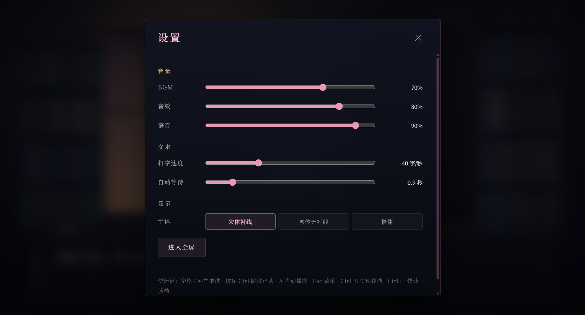
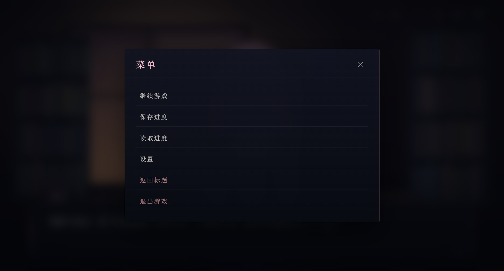
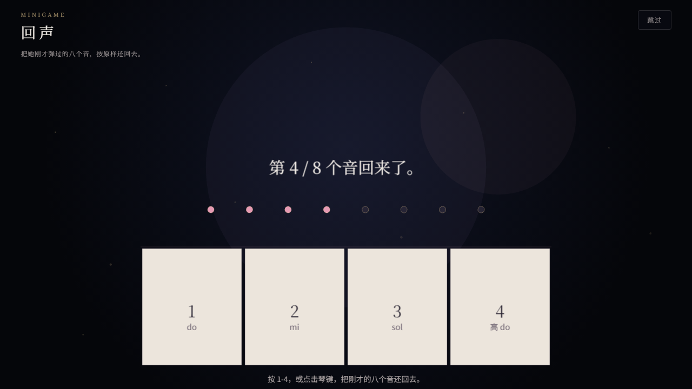

# SylvieGalGame · 一百二十日元的回声

> 一个由 YAML 剧本驱动的 Galgame 播放器：纯前端引擎内核 + React 分层舞台 + Electron 桌面外壳。
> 无编辑器、零服务器依赖，剧本与美术资源独立成包，可打包为 Windows 免安装版或 NSIS 安装包；
> 另带一个 Web 预览壳，方便在浏览器里用 HMR 和 DevTools 调试同一套界面与剧本。


## 简介

项目实现了一期完整的视觉小说游玩闭环：标题页 → 序章 → 分支选择 → 变量驱动的剧情收敛 → 结局。业务逻辑集中在纯 TypeScript 的 `engine-core`，UI 与桌面能力分别位于 `player` 和 `electron`，剧情与素材则完全剥离到 `game-content`，改剧情不需要改代码。

二期 M1 已补齐体验闭环：文本回滚、`{变量}` 插值、存档版本迁移、应用内确认框、自动存档减负、脚本警告面板与渲染错误边界。M2 继续完成稳定已读 id、`set` 表达式、选项内赋值动作、选项键盘操作、自动存档轮换与章节 / 结局元数据。

示例剧本《一百二十日元的回声》受经典日式短篇 Galgame「120 円」系列启发，围绕一枚刚好够买一罐热咖啡的硬币，讲述两个失眠的人在深夜售货机前相遇、靠近、又各自离开的故事。它包含：

- 5 个场景、3 条分支、3 个结局、共 149 句文本；
- 9 张背景（夜间街道、末班车站、旧音乐教室、图书馆等）、5 张 CG、4 版立绘；
- 2 首 BGM、6 个音效，支持图鉴试听与 CG 鉴赏；
- 背景 / 立绘 / CG 分层舞台与淡入淡出、溶解、滑动、擦除转场；
- BGM、音效与对话历史回放；
- 打字机、Auto、仅跳过已读的 Skip、Backlog；
- 自动存档保留最近 3 份轮换，快速存档、20 个手动存档位与截图缩略图；
- 设置面板：三类音量、打字速度、自动等待、字体、全屏；
- 音乐教室里的 Phaser 小游戏「回声」：听希尔维弹八个音，再按原样还回去，结果会写回剧本变量并影响后续对话。

## 功能特性

- **纯 YAML 驱动**：`label` / `jump` / `choice` / `set` / `if` / `wait` / `minigame` 等指令，跨场景跳转与条件显隐，启动时校验结构、目标与资源。
- **业务逻辑抽离**：`engine-core` 不依赖 React / DOM，可脱离桌面端在 Node 中运行与测试；`player` 只消费快照和效果事件。
- **分层渲染**：背景 → 多立绘 → CG → 环境特效 → 对话 UI → 选项 → 菜单遮罩，支持 fade / dissolve / slide / wipe 转场与逐条缓动；另提供 `shake` / `flash` 演出指令。
- **可配置环境特效**：标题页与任意场景都能用 YAML 的 `effect` 指令开启粒子（萤火虫 / 灯光光斑 / 浮尘），可覆盖数量、颜色、速度、区域、闪烁、光晕与混合方式；粒子由 tsParticles 渲染，特效配置写入舞台快照，随存档与回滚恢复。
- **文本体验**：逐字打字、点击补全、Auto、Ctrl 跳过已读、未读自动停止、历史回看与语音回放。
- **回滚与插值**：`PageUp` / 滚轮上滑回到最近 50 个阻塞点，完整恢复指针、变量、舞台与 BGM；`text` 支持 `{变量名}` 插值与 `{{` / `}}` 转义。
- **稳定已读与分支动作**：文本 id 按内容哈希生成，插入无关台词不会打乱 Skip 记录；`set` 支持表达式与字符串拼接，选项可在跳转前执行一组赋值。
- **章节与结局**：manifest 登记章节展示名与结局表，`ending` 指令结束本局；结局页显示标题与描述，存档面板显示可读章节名。
- **表现与标题配置**：立绘支持 `scale` / `z`；manifest 可配置窗口标题、标题背景、标题 BGM、副标题、版本显示与标题页特效；`H` / 右键一键隐藏界面。
- **音频续播**：存档记录 BGM 播放位置，读档后从原位置继续。
- **回忆图鉴**：标题页与游戏内菜单可查看 CG 鉴赏、音乐试听与结局列表；解锁记录独立于存档，首次触发即永久点亮。
- **音频管理**：BGM / SE / VO 独立音量与打断规则，进入场景预加载图片与音频。
- **存档系统**：指针、变量、图层、BGM 及播放位置、已读标记、Backlog 与截图完整落盘；手动 / 自动 / 快速三类存档，自动存档保留 3 份轮换，「继续游戏」取所有存档中最新的一份；带版本号与内容版本提示，旧版存档自动迁移。
- **存档导入导出**：存档面板支持全量与单档 JSON 导出、导入；桌面端使用系统文件对话框，Web 端使用浏览器下载 / 上传，导入前校验格式与键名白名单。
- **诊断与兜底**：脚本警告汇总到播放器内面板，可复制诊断信息；覆盖 / 删除 / 返回标题使用应用内确认框；渲染异常由 ErrorBoundary 兜底，避免白屏。桌面端运行日志按天写入 `%APPDATA%\SylvieGalGame\logs\`，错误页会显示存档与日志路径。
- **内容与代码分离**：打包时内容包被复制到 `resources/game`，替换资源即可更新剧情，无需重新编译。
- **桌面交付**：Electron 自定义协议限制资源访问，关闭 Node 集成；Forge + NSIS 生成 Windows 安装包；单实例运行并记忆窗口大小 / 位置。
- **Web 预览**：同一套 `@sylvie/player` 通过 HTTP + IndexedDB（localStorage 回退）平台适配器在浏览器中运行，改 UI / 剧本即时热更新；vendor、面板与截图库按需拆包。
- **可拔插剧情小游戏**：剧本用通用 `minigame` 指令阻塞并映射结果；宿主按 id 注入 loader，具体玩法独立在 `@sylvie/minigames`，Phaser 只在玩家真正进入小游戏时懒加载。

## 页面预览

| 对话与舞台 | 分支选择 |
| --- | --- |
|  |  |

| 存读档（截图缩略图） | 设置 |
| --- | --- |
|  |  |

| 游戏内菜单 | 对话历史 |
| --- | --- |
|  |  |

### 剧情小游戏「回声」

音乐教室里的 Phaser 小游戏：先听希尔维弹八个音，再按原样还回去。结果会写回剧本变量，影响她接下来的台词与尾声。



## 快速开始

要求 Windows 10/11、PowerShell 7（`pwsh`）、Node.js ≥ 20.11（`smoke` 需 22+）、pnpm ≥ 9；`docker:*` 操作另需 Docker Desktop（Compose v2）。首次使用先安装依赖：

```powershell
cd galgame-monorepo
pnpm install
```

之后统一通过根目录的 `manage.ps1` 运维：

```powershell
# 环境 / 产物 / 存档状态
pwsh ./manage.ps1 status

# 检查 Node、pnpm、依赖与内容包
pwsh ./manage.ps1 doctor

# 构建共享包并启动 Electron 开发模式
pwsh ./manage.ps1 dev

# 浏览器预览（http://127.0.0.1:5175），改 player 源码即时热更新
pwsh ./manage.ps1 web

# 构建 Web 镜像并启动容器（http://localhost:8080）
pwsh ./manage.ps1 docker:up

# 打包：免安装目录 + NSIS 安装包
pwsh ./manage.ps1 package
pwsh ./manage.ps1 make

# 自动验证：ESLint + typecheck + 单元测试 + 剧本校验
pwsh ./manage.ps1 verify

# 启动打包产物，自动验证回退、选项、存读档与设置并截图
pwsh ./manage.ps1 smoke

# Web 端冒烟：构建 + preview + 无头 Chrome，自动验证标题、推进、选项与存读档
cd galgame-monorepo
pnpm smoke:web
```

产物位置：

| 产物 | 路径 |
| --- | --- |
| 免安装版 | `galgame-monorepo/apps/electron/out/SylvieGalGame-win32-x64/SylvieGalGame.exe` |
| NSIS 安装包 | `galgame-monorepo/apps/electron/out/make/SylvieGalGame-Setup-0.1.0.exe` |
| Web 预览产物 | `galgame-monorepo/apps/web/dist/` |
| Web 镜像 | `sylvie-web:local`（容器 `sylvie-web`） |
| 冒烟截图 | `galgame-monorepo/scripts/.smoke/` |

### 版本与签名

版本号以 monorepo 根 `package.json` 为准，同步到 Electron / Web / 内容包与 `game.yaml`：

```powershell
cd galgame-monorepo
pnpm version:check     # CI / 提交前校验版本是否一致
pnpm version:set 0.2.0 # 一次性更新全部位置
```

可选 Windows 代码签名（未设置时保持未签名产物）：

```powershell
$env:WINDOWS_CERTIFICATE_FILE = 'C:\path\to\sylvie.pfx'
$env:WINDOWS_CERTIFICATE_PASSWORD = '...'
pnpm make
```

设置后 Electron exe 与 NSIS 安装包会使用该证书签名；时间戳默认使用 DigiCert。

### 发布流程

1. 在 [CHANGELOG.md](CHANGELOG.md) 的 `Unreleased` 下整理本次变更并改成目标版本。
2. `pnpm version:set 0.2.0`，确认 `pnpm version:check` 通过。
3. 提交后打 tag 并推送（推送需显式执行）：
   ```powershell
   git tag v0.2.0
   git push origin main --tags
   ```
4. `.github/workflows/release.yml` 会校验 tag 与版本号，运行 lint / typecheck / test / validate / Web 构建，然后在 Windows 上打包、冒烟、生成 NSIS 安装包，并上传：
   - `SylvieGalGame-<version>-win32-x64.zip`（免安装版）
   - `SylvieGalGame-Setup-<version>.exe`（NSIS 安装包）
   - `SHA256SUMS.txt`
5. 配置仓库 Secrets `WINDOWS_CERTIFICATE_PFX`（base64 的 pfx）与 `WINDOWS_CERTIFICATE_PASSWORD` 后，Release 产物会自动签名。
6. 需要发布或重跑时，可在 GitHub Actions 的 Release 工作流中点击「Run workflow」：填写目标 tag（如 `v0.1.0`，可新建）；`ref` 默认 `main`，也可填已存在的 tag 以使用该版本代码。

## Web 容器化

`scripts/docker-compose.yml` 只包含一个 `web` 服务：多阶段构建 `apps/web`，再把静态产物交给 Nginx。容器本身无状态，存档仍在访问者浏览器的 IndexedDB 中（不支持时回退 `localStorage`）。

```powershell
# 一键构建并启动（使用镜像内置内容）
pwsh ./manage.ps1 docker:up

# 内容热替换：把本地内容包只读挂载进容器，改剧本后刷新页面即可
pwsh ./manage.ps1 docker:up -GameContent

# 或直接使用 compose
docker compose -f scripts/docker-compose.yml up -d --build
docker compose -f scripts/docker-compose.yml -f scripts/docker-compose.game.yml up -d --build
```

| 配置 | 说明 |
| --- | --- |
| `scripts/docker-compose.yml` | Web 服务、端口映射与健康检查 |
| `scripts/docker-compose.game.yml` | 可选覆盖：本地内容包挂载到 `/usr/share/nginx/html/game` |
| `scripts/.env.example` | 复制为 `scripts/.env` 后可改 `WEB_PORT` / `NPM_REGISTRY` |
| `galgame-monorepo/apps/web/Dockerfile` | Node 22 构建 + Nginx 运行 |
| `galgame-monorepo/apps/web/nginx.conf` | 静态托管、`/game/` 禁止长期缓存、CSP 与 gzip |
| `galgame-monorepo/.dockerignore` | 排除 node_modules、dist、Electron 产物等 |

默认访问地址为 <http://localhost:8080>，健康检查端点 `/health`。Web 存档按浏览器 origin 隔离，修改 `WEB_PORT` 后相当于进入一套新的存档空间。

## manage.ps1

| 操作 | 说明 |
| --- | --- |
| `status` | 环境版本、内容包数量、构建产物、本地存档大小 |
| `doctor` | 前置条件检查，缺失时直接报错 |
| `dev` | 构建依赖包并启动 Electron 开发模式 |
| `web` | 启动 Web 预览壳（Vite HMR，端口 5175） |
| `docker:up` | 构建 Web 镜像并启动容器（默认 8080）；加 `-GameContent` 挂载本地内容包 |
| `docker:down` / `docker:restart` | 停止移除 / 重启 Web 容器 |
| `docker:build` | 仅构建镜像（`-Force` 禁用缓存） |
| `docker:logs` | 查看容器日志（可加 `-Follow`、`-Tail`） |
| `docker:status` | 查看容器健康状态与实际访问地址 |
| `build` | Turbo 构建全部包（含 Web 预览） |
| `package` / `make` | 生成免安装目录 / NSIS 安装包 |
| `smoke` | 启动已打包应用，CDP 驱动 UI 并截图（可传 `-ExePath`） |
| `verify` | 依次执行 lint、typecheck、test、validate |
| `lint` / `test` / `typecheck` / `validate` | 单项校验 |
| `assets` | 重新生成占位图片与图标（音频默认保留；加 `--placeholder-audio` 才生成旧占位音频） |
| `clean` | 清理构建产物（需确认，`-Force` 跳过） |
| `reset-saves` | 删除本地存档、已读标记与设置（需确认） |
| `output` | 打开打包产物目录 |

脚本会自动清除 `ELECTRON_RUN_AS_NODE`，避免 Electron 被当作 Node 运行时启动而报 `bad option`。

## 技术栈

- **引擎内核**：纯 TypeScript，YAML 解析、指针 + 阻塞调度、变量与条件表达式、已读标记、存档序列化
- **播放器**：React 19、Tailwind CSS v4、Motion 12、Zustand 5、Howler.js、tsParticles（环境粒子，按需加载）
- **剧情小游戏**：Phaser 4，独立 `@sylvie/minigames` 包与宿主 loader 注册表
- **桌面端**：Electron 45、Electron Forge 8、Vite 8、NSIS
- **Web 预览**：Vite 8 + React 19（源码别名热更新、`/game` 资源中间件、IndexedDB 存档 + localStorage 回退）
- **Web 容器化**：Docker Compose + Node 22 多阶段构建 + Nginx 静态托管
- **工程**：pnpm workspace + Turborepo、ESLint 9 平面配置、Vitest、TypeScript strict

## 目录结构

```text
SylvieGalGame/
├── CHANGELOG.md                      # 版本变更记录（Keep a Changelog）
├── .github/workflows/                # CI 与 tag 发布流水线
├── docs/
│   ├── SylvieGalGame需求整理-v1.md   # 一期需求
│   ├── SylvieGalGame需求整理-v2.md   # 二期需求与里程碑
│   └── screenshots/                  # README 截图
├── galgame-monorepo/
│   ├── apps/
│   │   ├── electron/                 # 主进程、preload、桌面能力与打包配置
│   │   └── web/                      # Web 预览壳：浏览器平台适配器与 Vite 配置
│   ├── packages/
│   │   ├── engine-core/              # 纯 TS 剧本引擎（含 Vitest）
│   │   ├── player/                   # React 播放器
│   │   ├── minigames/                # Phaser 剧情小游戏与 loader 注册表
│   │   ├── game-content/             # 内容包：剧本 + 图片 + 音频（无构建步骤）
│   │   ├── types/                    # 跨包共享类型
│   │   ├── eslint-config/            # 共享 ESLint 平面配置（base / react）
│   │   └── tsconfig/                 # 共享 TS 配置
│   ├── scripts/                      # 资源生成、内容校验、冒烟测试
│   └── docs/
│       ├── 剧本格式.md                 # YAML 指令参考
│       └── script.schema.json          # 编辑器 Schema（VSCode YAML 插件）
├── scripts/
│   ├── docker-compose.yml            # Web 静态站容器编排
│   └── .env.example                  # 端口与依赖源示例
├── manage.ps1                        # 开发 / 校验 / 打包 / 容器运维入口
└── README.md
```

## 内容替换

剧情和素材全部位于 `galgame-monorepo/packages/game-content/game/`：

```text
game/
├── scripts/game.yaml        # 标题、入口场景、场景列表、初始变量
├── scripts/scenes/*.yaml    # 场景剧本
├── images/                  # bg / sprite / cg
└── audio/                   # bgm / se / voice
```

替换后执行：

```powershell
pwsh ./manage.ps1 validate
```

该命令会解析全部场景、检查标签跳转、表达式与资源存在性，做内容体检（未引用资源、不可达场景、超大资源、命名规范），并实际走通所有分支；诊断带 `scene.yaml:行号`，区分错误与警告，任意一条即以非零码退出。

编辑器体验：`galgame-monorepo/docs/script.schema.json` 提供完整 YAML Schema，仓库已通过 `.vscode/settings.json` 映射到清单与场景文件，安装 YAML 插件即可补全与内联报错。

## 快捷键

| 按键 | 行为 |
| --- | --- |
| 空格 / 回车 / 点击 | 打字中补全全文；等待中推进 |
| 选项界面 `↑` / `↓` / `1`–`9` / `Enter` | 切换、直选或确认选项 |
| `H` / 右键 | 隐藏 / 恢复对话与快捷栏 |
| `A` | Auto 开关 |
| `Ctrl` | Skip 开关（遇到未读文本自动停止） |
| `PageUp` / 滚轮上滑 | 回到上一个文本、选项或等待 |
| `Esc` | 打开 / 关闭菜单 |
| `Ctrl+S` / `Ctrl+L` | 快速存档 / 快速读档 |

## 文档

- [一期需求](docs/SylvieGalGame需求整理-v1.md)：一期功能范围
- [二期需求](docs/SylvieGalGame需求整理-v2.md)：优化项、优先级与里程碑
- [剧本格式](galgame-monorepo/docs/剧本格式.md)：清单、场景、全部指令与表达式
- [工程说明](galgame-monorepo/README.md)：架构、数据流、开发与打包细节

## 一期边界

- 无剧本编辑器，剧情直接写 YAML。
- 未做 3D 转场；现有转场为 fade / dissolve / slide / wipe。环境特效目前只有 tsParticles 粒子，雨、雾等类型可按同一套 `kind` 机制扩展。
- 资源为松散文件，未加密或压缩。
- 美术与音频为程序生成的占位素材，可直接替换为正式资源。
- 安装包未签名，Windows SmartScreen 可能提示。
- 本地存档：桌面端写入 `%APPDATA%\SylvieGalGame\game-storage.json`；Web 预览优先写入 IndexedDB，不支持时回退 `localStorage`（`sylvie:` 前缀），缩略图存为 JPEG 以控制容量。
- Web 预览若提示存储空间不足，可在控制台执行 `window.sylvieWeb.resetStorage()` 清空预览存档。
- Docker 容器本身无状态；更换 `WEB_PORT` 会改变浏览器 origin，旧存档不会随之迁移。
- Web 预览壳只用于调试与静态预览，正式交付仍以 Electron 打包产物为准。
- `smoke` 依赖 Node.js 22+ 的内置 WebSocket；其余开发与打包操作 Node 20.11+ 即可。

## License

[MIT](LICENSE)
