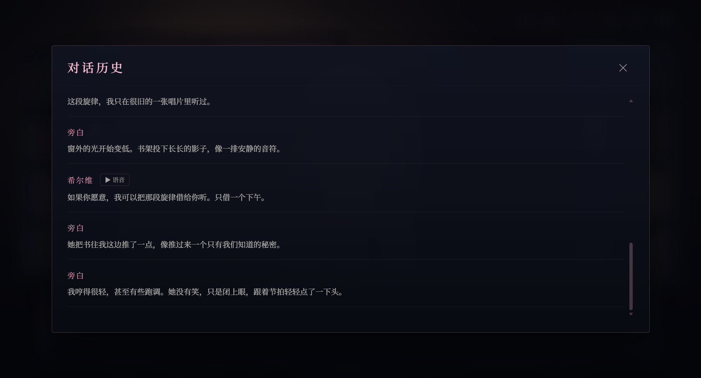

# SylvieGalGame · 午后的回声

> 一个由 YAML 剧本驱动的 Galgame 播放器：纯前端引擎内核 + React 分层舞台 + Electron 桌面外壳。
> 无编辑器、零服务器依赖，剧本与美术资源独立成包，可打包为 Windows 免安装版或 NSIS 安装包。


## 简介

项目实现了一期完整的视觉小说游玩闭环：标题页 → 序章 → 分支选择 → 变量驱动的剧情收敛 → 结局。业务逻辑集中在纯 TypeScript 的 `engine-core`，UI 与桌面能力分别位于 `player` 和 `electron`，剧情与素材则完全剥离到 `game-content`，改剧情不需要改代码。

示例剧本《午后的回声》包含：

- 4 个场景、2 条分支、2 次选择、2 个结局；
- 背景 / 立绘 / CG 分层舞台与淡入淡出；
- BGM、音效、角色语音与对话历史回放；
- 打字机、Auto、仅跳过已读的 Skip、Backlog；
- 自动存档、快速存档、20 个手动存档位与截图缩略图；
- 设置面板：三类音量、打字速度、自动等待、字体、全屏。

## 功能特性

- **纯 YAML 驱动**：`label` / `jump` / `choice` / `set` / `if` / `wait` 等指令，跨场景跳转与条件显隐，启动时校验结构、目标与资源。
- **业务逻辑抽离**：`engine-core` 不依赖 React / DOM，可脱离桌面端在 Node 中运行与测试；`player` 只消费快照和效果事件。
- **分层渲染**：背景 → 多立绘 → CG → 对话 UI → 选项 → 菜单遮罩，支持 fade / none 转场。
- **文本体验**：逐字打字、点击补全、Auto、Ctrl 跳过已读、未读自动停止、历史回看与语音回放。
- **音频管理**：BGM / SE / VO 独立音量与打断规则，进入场景预加载图片与音频。
- **存档系统**：指针、变量、图层、BGM、已读标记、Backlog 与截图完整落盘；手动 / 自动 / 快速三类存档。
- **内容与代码分离**：打包时内容包被复制到 `resources/game`，替换资源即可更新剧情，无需重新编译。
- **桌面交付**：Electron 自定义协议限制资源访问，关闭 Node 集成；Forge + NSIS 生成 Windows 安装包。

## 页面预览

| 对话与舞台 | 分支选择 |
| --- | --- |
|  |  |

| 存读档（截图缩略图） | 设置 |
| --- | --- |
|  |  |

| 游戏内菜单 | 对话历史 |
| --- | --- |
|  |  |

## 快速开始

要求 Windows 10/11、PowerShell 7（`pwsh`）、Node.js ≥ 20.11（`smoke` 需 22+）、pnpm ≥ 9。首次使用先安装依赖：

```powershell
cd galgame-monorepo
pnpm install
```

之后统一通过根目录的 `manage.ps1` 运维：

```powershell
# 环境 / 产物 / 存档状态
pwsh ./manage.ps1 status

# 检查 Node、pnpm、依赖与内容包
pwsh ./manage.ps1 doctor

# 构建共享包并启动 Electron 开发模式
pwsh ./manage.ps1 dev

# 打包：免安装目录 + NSIS 安装包
pwsh ./manage.ps1 package
pwsh ./manage.ps1 make

# 自动验证：typecheck + 单元测试 + 剧本校验
pwsh ./manage.ps1 verify

# 启动打包产物，自动点到选项、存读档与设置并截图
pwsh ./manage.ps1 smoke
```

产物位置：

| 产物 | 路径 |
| --- | --- |
| 免安装版 | `galgame-monorepo/apps/electron/out/SylvieGalGame-win32-x64/SylvieGalGame.exe` |
| NSIS 安装包 | `galgame-monorepo/apps/electron/out/make/SylvieGalGame-Setup-0.1.0.exe` |
| 冒烟截图 | `galgame-monorepo/scripts/.smoke/` |

## manage.ps1

| 操作 | 说明 |
| --- | --- |
| `status` | 环境版本、内容包数量、构建产物、本地存档大小 |
| `doctor` | 前置条件检查，缺失时直接报错 |
| `dev` | 构建依赖包并启动 Electron 开发模式 |
| `build` | Turbo 构建全部包 |
| `package` / `make` | 生成免安装目录 / NSIS 安装包 |
| `smoke` | 启动已打包应用，CDP 驱动 UI 并截图（可传 `-ExePath`） |
| `verify` / `test` / `typecheck` / `validate` | 全量或单项校验 |
| `assets` | 重新生成占位图片、音频与图标 |
| `clean` | 清理构建产物（需确认，`-Force` 跳过） |
| `reset-saves` | 删除本地存档、已读标记与设置（需确认） |
| `output` | 打开打包产物目录 |

脚本会自动清除 `ELECTRON_RUN_AS_NODE`，避免 Electron 被当作 Node 运行时启动而报 `bad option`。

## 技术栈

- **引擎内核**：纯 TypeScript，YAML 解析、指针 + 阻塞调度、变量与条件表达式、已读标记、存档序列化
- **播放器**：React 19、Tailwind CSS v4、Motion 12、Zustand 5、Howler.js
- **桌面端**：Electron 45、Electron Forge 8、Vite 8、NSIS
- **工程**：pnpm workspace + Turborepo、Vitest、TypeScript strict

## 目录结构

```text
SylvieGalGame/
├── docs/
│   ├── SylvieGalGame需求整理-v1.md   # 一期需求
│   └── screenshots/                  # README 截图
├── galgame-monorepo/
│   ├── apps/
│   │   └── electron/                 # 主进程、preload、桌面能力与打包配置
│   ├── packages/
│   │   ├── engine-core/              # 纯 TS 剧本引擎（含 Vitest）
│   │   ├── player/                   # React 播放器
│   │   ├── game-content/             # 内容包：剧本 + 图片 + 音频（无构建步骤）
│   │   ├── types/                    # 跨包共享类型
│   │   └── tsconfig/                 # 共享 TS 配置
│   ├── scripts/                      # 资源生成、内容校验、冒烟测试
│   └── docs/剧本格式.md               # YAML 指令参考
├── manage.ps1                        # 开发 / 校验 / 打包 / 运维入口
└── README.md
```

## 内容替换

剧情和素材全部位于 `galgame-monorepo/packages/game-content/game/`：

```text
game/
├── scripts/game.yaml        # 标题、入口场景、场景列表、初始变量
├── scripts/scenes/*.yaml    # 场景剧本
├── images/                  # bg / sprite / cg
└── audio/                   # bgm / se / voice
```

替换后执行：

```powershell
pwsh ./manage.ps1 validate
```

该命令会解析全部场景、检查标签跳转、表达式与资源存在性，并实际走通所有分支；有警告即以非零码退出。

## 快捷键

| 按键 | 行为 |
| --- | --- |
| 空格 / 回车 / 点击 | 打字中补全全文；等待中推进 |
| `A` | Auto 开关 |
| `Ctrl` | Skip 开关（遇到未读文本自动停止） |
| `Esc` | 打开 / 关闭菜单 |
| `Ctrl+S` / `Ctrl+L` | 快速存档 / 快速读档 |

## 文档

- [需求整理](docs/SylvieGalGame需求整理-v1.md)：一期功能范围
- [剧本格式](galgame-monorepo/docs/剧本格式.md)：清单、场景、全部指令与表达式
- [工程说明](galgame-monorepo/README.md)：架构、数据流、开发与打包细节

## 一期边界

- 无剧本编辑器，剧情直接写 YAML。
- 转场仅支持 `fade` / `none`，未做擦除、滑动、粒子。
- 资源为松散文件，未加密或压缩。
- 美术与音频为程序生成的占位素材，可直接替换为正式资源。
- 安装包未签名，Windows SmartScreen 可能提示。
- 本地存档统一写入 `%APPDATA%\SylvieGalGame\game-storage.json`。
- `smoke` 依赖 Node.js 22+ 的内置 WebSocket；其余开发与打包操作 Node 20.11+ 即可。

## License

[MIT](LICENSE)
